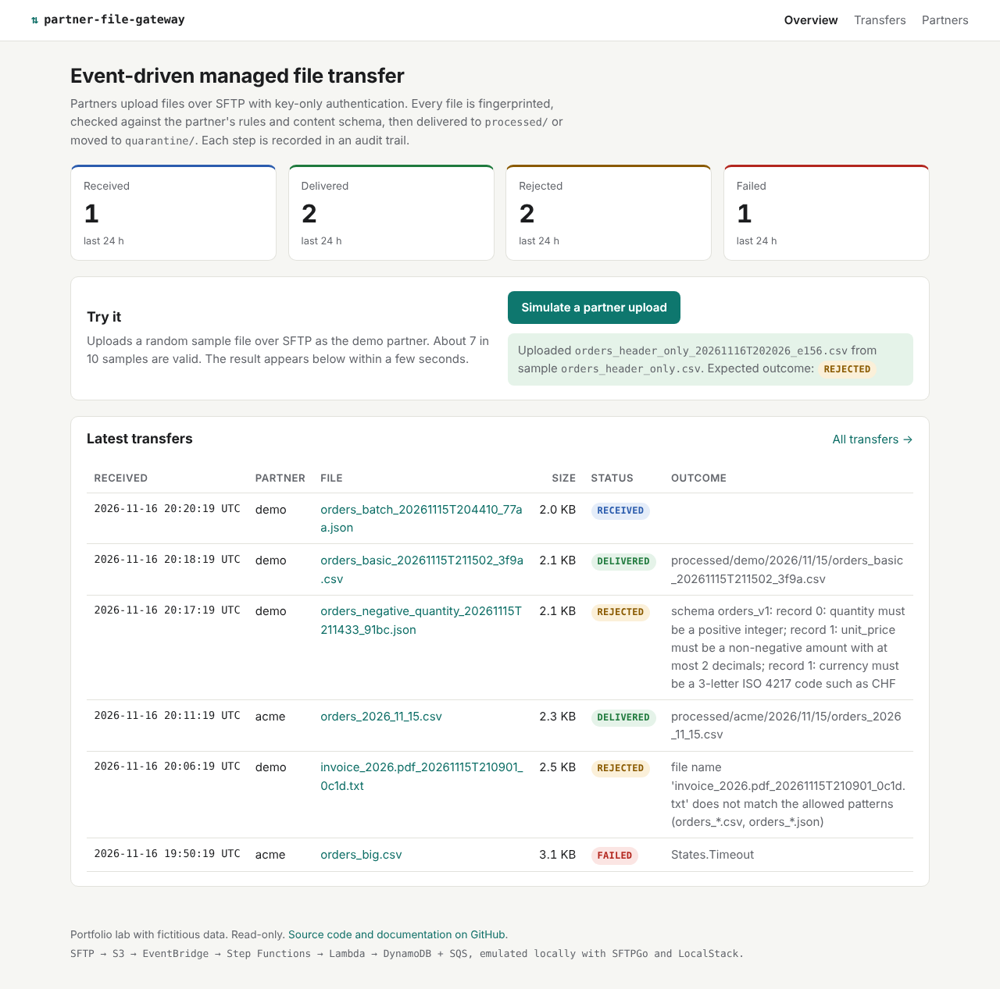
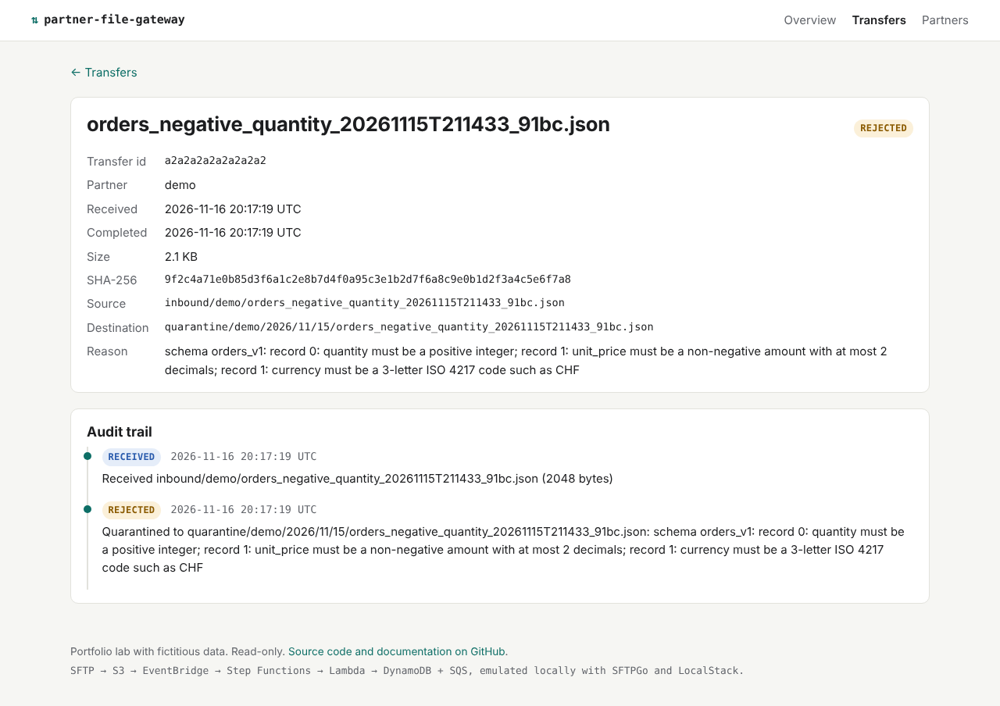
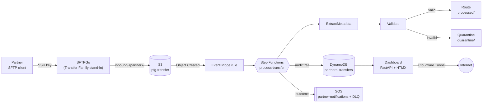

# partner-file-gateway

[](https://github.com/andrea-claro/partner-file-gateway/actions/workflows/ci.yml)
[](LICENSE)

**Live demo: <https://file-gtw-lab.clarotech.net>**

A small B2B **managed file transfer** platform with the architecture of AWS
Transfer Family, running entirely on one machine at zero cloud cost.

Partners upload files over SFTP with key-only authentication. Files land in S3,
and an event-driven pipeline (EventBridge → Step Functions → Lambda) fingerprints
and validates every file, delivers it to `processed/` or moves it to
`quarantine/`, writes an audit trail to DynamoDB and publishes a notification to
SQS. A read-only dashboard shows what happened and lets visitors trigger a real
upload.

The project is a lab built **AI-first**: coding agents implement tasks from
[PLAN.md](PLAN.md), the author designs, reviews and decides what ships. The
process, with the mistakes the review caught, is in
[How this was built](docs/how-this-was-built.md).

## Try the live demo

1. Open <https://file-gtw-lab.clarotech.net>.
2. Press **Simulate a partner upload**. The server uploads one of the bundled
   sample files over SFTP as the demo partner; about 7 in 10 are valid.
3. Within a few seconds the file appears under **Latest transfers** as
   `DELIVERED`, or as `REJECTED` with the reason (wrong file name, bad schema…).
4. Click the file name to see its **audit trail**: every status change with its
   timestamp, the SHA-256 fingerprint and where the file was moved.
5. **Partners** lists the onboarded partners with their allowed file patterns,
   size limits and SSH key fingerprints.

The demo runs on a single laptop behind Cloudflare Tunnel, uses fictitious data
and is read-only apart from the rate-limited simulate button. If it is offline,
the [quickstart](#quickstart) runs the same stack locally.

| Overview | Transfer audit trail |
|---|---|
|  |  |

<sub>Screenshots rendered with sample data.</sub>

## What this project shows

| Topic | Where to look |
|---|---|
| AWS managed file transfer architecture: Transfer Family-style SFTP, S3, EventBridge, Step Functions, Lambda, DynamoDB, SQS | [Architecture](docs/architecture.md), [state machine](statemachine/process_transfer.asl.json) |
| Infrastructure as Code: reusable Terraform modules, a LocalStack target and a real-AWS target that is validated but never applied | [`infra/`](infra), [ADR-005](docs/adr/ADR-005-two-terraform-targets.md) |
| Automated partner onboarding and SSH key rotation | [`cli/pfg`](cli/pfg), [lifecycle e2e tests](tests/e2e/test_partner_lifecycle.py) |
| Security by default: key-only SFTP, least-privilege IAM, encryption, audit trail, one public endpoint | [Security and compliance](#security-and-compliance) |
| Reliability: idempotent processing, retries, dead-letter queue | [ADR-004](docs/adr/ADR-004-idempotency.md), [Architecture](docs/architecture.md#idempotency) |
| CI/CD with lint, policy as code (checkov), secret scanning and tests | [`ci.yml`](.github/workflows/ci.yml) |
| AI-first engineering with human review | [How this was built](docs/how-this-was-built.md) |

## Architecture



| Target AWS service | Local stand-in | Notes |
|---|---|---|
| AWS Transfer Family (SFTP) | [SFTPGo](https://github.com/drakkan/sftpgo) | Users via REST API, S3 backend jailed to `inbound/<partner>/`, key-only auth |
| S3, EventBridge, Step Functions, Lambda, DynamoDB, SQS, IAM, CloudWatch Logs | [LocalStack](https://www.localstack.cloud/) | Free Hobby plan (auth token) |
| Transfer Family in Terraform | `infra/envs/aws` | `terraform validate` in CI, never applied |

Details: [docs/architecture.md](docs/architecture.md) · decisions: [docs/adr](docs/adr).

## Quickstart

Prerequisites: **Docker Desktop, `make` and `git`**. Terraform, Python, the AWS
CLI, ruff, pytest, tflint and checkov all run in a `tools` container. You also
need a free [LocalStack](https://app.localstack.cloud) Hobby account for its
auth token.

```sh
make secrets   # creates .env (gitignored); put your LOCALSTACK_AUTH_TOKEN in it
make demo      # stack + Terraform on LocalStack + demo partner
open http://localhost:8000
```

The first run builds two local images and pulls the Lambda runtime image, so the
first transfer can take a minute. Then press **Simulate a partner upload**, or
upload a file yourself as the demo partner:

```sh
sftp -i .secrets/partners/demo/id_ed25519 -o UserKnownHostsFile=.secrets/sftpgo/known_hosts \
     -P 2022 demo@localhost <<< "put samples/valid/orders_basic.csv"
```

Onboard your own partner and manage its key:

```sh
make pfg ARGS="partner create --name acme --display-name 'ACME Ltd' --generate-key --pattern 'orders_*.csv'"
make pfg ARGS="partner rotate-key --name acme --generate-key"   # old key refused immediately
make pfg ARGS="partner disable --name acme"                      # login blocked, files rejected
make pfg ARGS="partner list"
```

## What happens to a file

1. **ExtractMetadata** derives the partner from the key, the SHA-256 and a
   deterministic transfer id (object key + version + ETag).
2. **RecordReceived** writes `RECEIVED` with a conditional put: a duplicate
   delivery of the same event stops here.
3. **Validate** checks that the partner exists and is active, the file name
   matches the partner's patterns, the size is within limits and the content
   matches the partner's schema (`orders_v1`, CSV or JSON).
4. **Route** or **Quarantine** moves the exact object version to
   `processed/<partner>/<yyyy>/<mm>/<dd>/` or `quarantine/…` with the reason.
5. **RecordOutcome** finalises the audit trail (`DELIVERED` or `REJECTED`) and
   **Notify** sends the outcome to SQS.
6. Any error → `FAILED` in the audit trail and the event in the dead-letter queue.

## Security and compliance

- **Key-only SFTP**: password and keyboard-interactive auth are disabled globally
  and per user; partners can only list and upload inside their own prefix.
- **Least privilege**: one IAM role per Lambda, scoped to the bucket prefixes and
  table it needs; no `*` actions on `*` resources (checkov in CI).
- **Encryption**: SSE on S3, DynamoDB and SQS locally; a customer managed KMS key
  with rotation in `envs/aws`. TLS-only bucket policy, public access blocked.
- **Audit trail**: every transfer has a status history in DynamoDB; Lambdas log
  one JSON line per event with the `transfer_id`.
- **Small public surface**: only the dashboard is published (Cloudflare Tunnel).
  SFTP, the SFTPGo admin API and LocalStack bind to `127.0.0.1`. The dashboard is
  read-only, sends a strict CSP and rate-limits the upload simulator.
- **No secrets in git**: see below.

## Secrets

| What | Where | Committed? |
|---|---|---|
| LocalStack auth token, SFTPGo admin password | `.env` (mode 600, created by `make secrets`) | never |
| Partner private keys | `.secrets/partners/<id>/` (mode 600, written by `pfg`) | never |
| Pinned SFTP host key | `.secrets/sftpgo/known_hosts` (written by `make up`) | never |
| Placeholders for every variable | `.env.example` | yes |

`make hooks` installs a pre-commit hook that refuses `.env`/`.secrets/` files and
runs gitleaks on staged changes; CI runs gitleaks on the full history.

## Publishing the dashboard

Only the dashboard should be reachable from the internet. With a Cloudflare
Tunnel already running on the host, add a *Published application* route:
`files.<your-domain>` → `http://localhost:8000`. The live demo at
<https://file-gtw-lab.clarotech.net> is published exactly this way. Never route ports 2022, 8080 or
4566. Without a host tunnel, set `TUNNEL_TOKEN` in `.env` and run `make tunnel`
(the bundled `cloudflared` sits on a network that contains only the dashboard).

## Operating notes

- LocalStack's free Hobby plan keeps no state across restarts. After a restart
  of the machine or of Docker, run `make demo` again: Terraform and the demo
  partner are re-created idempotently (the transfer history starts empty).
- The demo is only online while the host is awake; `restart: unless-stopped`
  brings the containers back after Docker restarts.

## Development

| Command | What it does |
|---|---|
| `make test` | ruff, terraform fmt, tflint and unit tests (moto, no network) |
| `make security` | checkov on all Terraform |
| `make validate` | `terraform validate` on `envs/local` and `envs/aws` |
| `make e2e` | end-to-end tests against the running stack |
| `make help` | every target |

CI (`.github/workflows/ci.yml`) runs lint, security (gitleaks + checkov), unit
tests, validation of both Terraform targets and, with a LocalStack CI token, the
end-to-end suite.

```
cli/                 pfg: partner onboarding and key management (Typer)
docker/tools/        toolbox image used by the Makefile
infra/modules/       storage, registry, events, pipeline, transfer_aws
infra/envs/          local (LocalStack) and aws (validate-only)
services/lambdas/    extract_metadata, validate, route, quarantine
services/dashboard/  FastAPI + Jinja2 + HTMX
statemachine/        process_transfer.asl.json
samples/             valid and invalid partner files
tests/               unit (moto), integration and e2e (live stack)
docs/                architecture, ADRs, how this was built
```

## Licence

[MIT](LICENSE)
