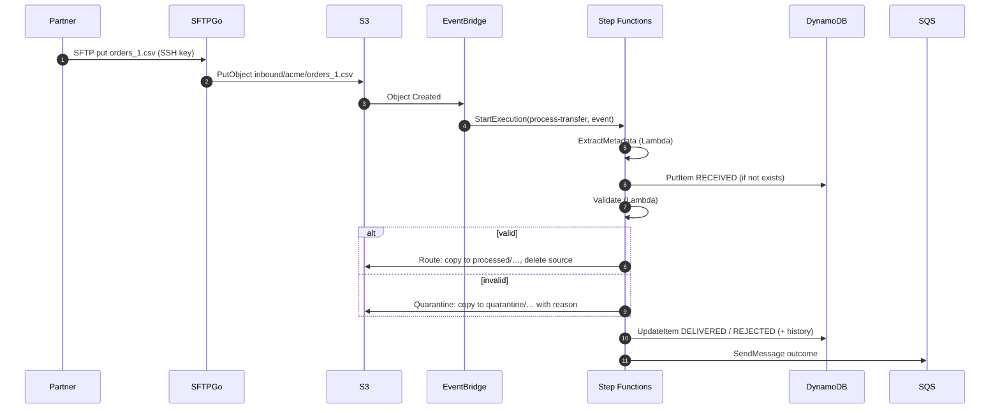
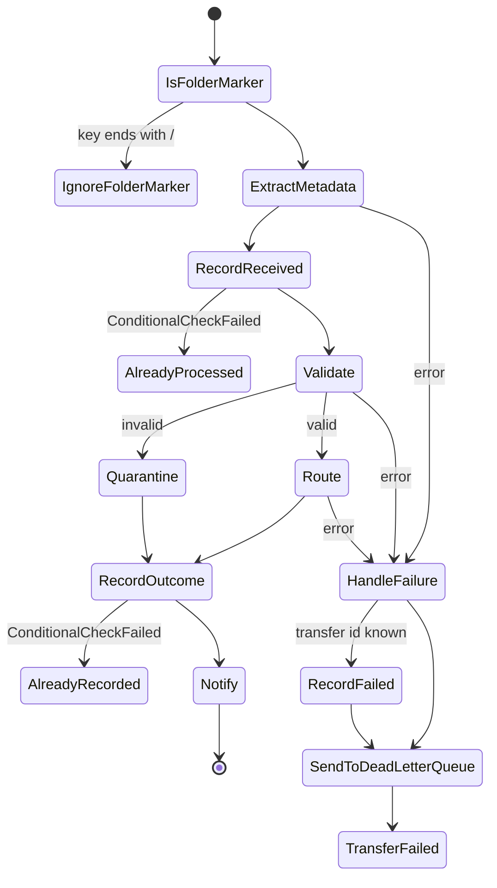

# Architecture

## Components

| Component | Runs as | Role |
|---|---|---|
| SFTPGo | container `sftpgo` | SFTP endpoint for partners (AWS Transfer Family stand-in). One user per partner, S3 backend with key prefix `inbound/<partner>/`. |
| LocalStack | container `localstack` | S3, EventBridge, Step Functions, Lambda, DynamoDB, SQS, IAM, CloudWatch Logs. Lambdas run as sibling containers through the Docker socket. |
| Lambdas | LocalStack | `extract_metadata`, `validate`, `route`, `quarantine` (Python 3.12, no third-party dependencies). |
| Dashboard | container `dashboard` | Read-only FastAPI app on `localhost:8000`; the only component that may be published (optional tunnel). |
| pfg | `tools` container | CLI that onboards partners (DynamoDB + S3 + SFTPGo REST API). |
| cloudflared | container (optional) | Only if no Cloudflare Tunnel runs on the host. |

All infrastructure inside LocalStack is created by Terraform (`infra/envs/local`).

## Data flow



## State machine



Every Task state has a timeout, retries only for transient errors, and a
`States.ALL` catcher. Conditional writes are never retried on generic errors,
because that would also retry the idempotency check. The structure is enforced
by `tests/unit/statemachine/test_process_transfer_asl.py`.

## Data model

**Bucket `pfg-transfer`**

```
inbound/<partner>/<path>                          partner uploads (SFTPGo jail)
processed/<partner>/<yyyy>/<mm>/<dd>/<path>       delivered files
quarantine/<partner>/<yyyy>/<mm>/<dd>/<path>      rejected files (expire after 90 days)
```

Versioned, SSE, TLS-only, public access blocked. Moved files carry
`pfg-transfer-id`, `pfg-sha256` and, in quarantine, `pfg-quarantine-reason` as
object metadata.

**Table `partners`** (key `partner_id`): `name`, `status` (`ACTIVE` | `DISABLED`),
`allowed_patterns`, `max_file_size_bytes`, `schema`, `public_key`,
`key_fingerprint`, timestamps. Source of truth for SFTPGo users: `pfg` rebuilds
the SFTPGo user from this record on every change.

**Table `transfers`** (key `transfer_id`, GSI `by_partner` on
`partner_id` + `received_at`): `status` (`RECEIVED` → `DELIVERED` | `REJECTED` |
`FAILED`), source and destination keys, size, SHA-256, reason or error,
`execution_arn` and `history` (one entry per status change).

**Queues**: `partner-notifications` (outcome per transfer) with
`partner-notifications-dlq` (failed transfers and undeliverable events), plus
`pfg-debug-events` locally (a copy of every inbound event).

## Idempotency

EventBridge delivers at least once. The transfer id is a hash of bucket, key,
version id and ETag, so the same S3 event always maps to the same id, while a
partner re-sending an identical file (a new object version) gets a new one. The
first write is `PutItem … attribute_not_exists(transfer_id)`; a duplicate ends in
`AlreadyProcessed` without touching S3. See [ADR-004](adr/ADR-004-idempotency.md).

## Security

- **Authentication**: SFTP public keys only (global `password_authentication=false`
  and per-user denied login methods). `pfg` rejects RSA keys under 3072 bits.
- **Authorisation**: SFTPGo users can `list`, `upload`, `overwrite` and
  `create_dirs` inside their own prefix, nothing else. On AWS the same jail is a
  logical home directory plus an IAM role limited to `inbound/<partner>/`.
- **Least privilege IAM**: per-function roles (see `infra/modules/pipeline`). The
  only `Resource: "*"` grant is the CloudWatch Logs delivery set for Step Functions,
  which AWS does not support at resource level.
- **Network**: every published port binds to `127.0.0.1`. The dashboard is also on
  an `edge` network that contains only itself and `cloudflared`.
- **Secrets**: `.env` and `.secrets/` are local only; the SFTP host key is pinned
  by clients; nothing secret is baked into images.
- **Dashboard hardening**: read-only container filesystem, non-root user, all
  capabilities dropped, strict CSP without inline scripts, no API docs,
  rate-limited simulator (per IP and global), HTMX-only POST.

## Local versus AWS

| Concern | Local | `infra/envs/aws` |
|---|---|---|
| SFTP | SFTPGo | Transfer Family, service-managed users |
| Encryption | SSE-S3 / AWS owned keys | customer managed KMS key with rotation |
| Credentials | LocalStack dummy `test`/`test` | IAM roles, no static keys |
| State | local file, recreated with `make infra` | remote backend (documented, not configured) |
| Apply | `make infra` | never (validate only, guarded by `allowed_account_ids`) |

## Known limitations

- LocalStack Hobby does not persist state across restarts: after restarting the
  stack run `make demo` again (idempotent). Automating this was left out on
  purpose to keep the lab simple.
- The dashboard scans the `transfers` table; fine for a demo, not for millions of
  rows (a status/date GSI would replace it).
- FTPS, malware scanning and outbound delivery are out of scope for now (PLAN.md
  cut line and stretch goals).
